<div align="center">


<a href="https://git.io/typing-svg">
  
</a>

<br/>


<a href="mailto:potnuruavinash111@gmail.com"></a>

<a href="https://avinashpotnuruportfolio.netlify.app/"></a>

</div>


##  About Me

<div align="center">
  
</div>

I turn product ideas and Figma files into fast, accessible, production-ready interfaces. Over the last **5+ years** I've shipped e-commerce, dashboard, booking, and mobile products with **React, Next.js, TypeScript, and React Native** — obsessing over rendering strategy, bundle size, and the interaction details that make a UI feel premium.

- **Focus:** Performance-first React and Next.js apps, reusable UI systems, and clean, scalable architecture.
- **Craft:** SSR / SSG / ISR / CSR, API caching, code splitting, state management, and JWT / OAuth2 authentication.
- **Currently exploring:** Advanced React Native patterns and frontend performance engineering.
- **Open to:** Frontend and React Developer roles — remote or on-site.


##  Skills & Expertise

<div align="center">



</div>


##  Roles & Responsibilities

### React Developer

- Designed and developed high-performance SPAs using **React.js** and **TypeScript**, focused on scalability and maintainability.
- Implemented **Redux Toolkit** and **Context API** for state management, reducing API calls and improving responsiveness.
- Built reusable UI components with **Tailwind CSS** and **Material UI**, accelerating feature delivery by **25%**.
- Optimized performance via **code splitting** and **lazy loading**, yielding **20% faster load times** and better SEO.
- Integrated **Razorpay UPI** payments securely in collaboration with backend teams.
- Optimized API performance and **data caching** strategies with backend developers.
- Built cross-platform mobile apps with **React Native (Expo)**, **React Query**, and Redux Toolkit.


##  Featured Projects

<div align="center">

| Project | Stack | Highlights |
| :------ | :---- | :--------- |
| **Babyshop E-Commerce Web App** | React.js · Next.js · Redux Toolkit · Tailwind CSS · Material UI | JWT auth, dynamic filtering & search, **20% faster** loads via code splitting |
| **RC Parish Website & Dashboard** | React.js · TypeScript · Zustand · Tailwind CSS · Shadcn UI | Legacy-to-React migration, type-safe forms (RHF + Zod), SEO-optimized routing |
| **CineWave — Movies & TV Explorer** | React Native (Expo) · TypeScript · TanStack Query · Firebase · TMDB API | Infinite queries, debounced search, FlatList virtualization, memoized rendering |
| **Activity Tracker** | React.js · Next.js · Redux · TypeScript · Recharts | Role-based access, SSO + JWT, 20+ pixel-perfect pages, **10% fewer** API calls |
| **Feu Restaurant Booking** | Next.js · Redux Toolkit · HTML5 · CSS3 | Slot booking with calendar availability, cart & ordering flow, responsive design |

</div>


##  GitHub Analytics

<div align="center">



<br/>



<br/>



<br/>



</div>

<details>
<summary><b>Optional: contribution snake animation</b></summary>

The snake only appears after the workflow runs, so it is not embedded here until it has generated its first SVG.

1. In your profile repository (`AvinashPotnuru/AvinashPotnuru`), add the workflow below.
2. Add `.github/workflows/snake.yml` to that repository:

```yaml
name: Generate Snake
on:
  schedule:
    - cron: "0 */12 * * *"
  workflow_dispatch:
jobs:
  build:
    runs-on: ubuntu-latest
    steps:
      - uses: Platane/snk/svg-only@v3
        with:
          github_user_name: ${{ github.repository_owner }}
          outputs: |
            dist/github-contribution-grid-snake.svg
            dist/github-contribution-grid-snake-dark.svg?palette=github-dark
      - uses: crazy-max/ghaction-github-pages@v4
        with:
          target_branch: output
          build_dir: dist
        env:
          GITHUB_TOKEN: ${{ secrets.GITHUB_TOKEN }}
```

3. Run the workflow once from the **Actions** tab.
4. Once it completes, add this below the streak card:

```html

```

</details>


##  Education

**Bachelor of Technology (B.Tech) — Mechanical Engineering**
Sri Sivani College of Engineering, India · 2012 – 2016


##  Connect With Me

<div align="center">

<a href="https://avinashpotnuruportfolio.netlify.app/"></a>
<a href="mailto:potnuruavinash111@gmail.com"></a>
<a href="https://github.com/Avinashpotnuru"></a>

<br/><br/>


<br/>


</div>
